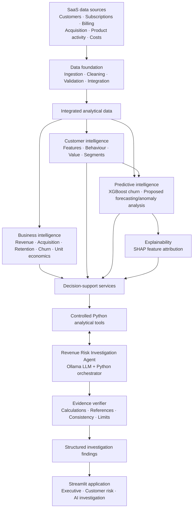
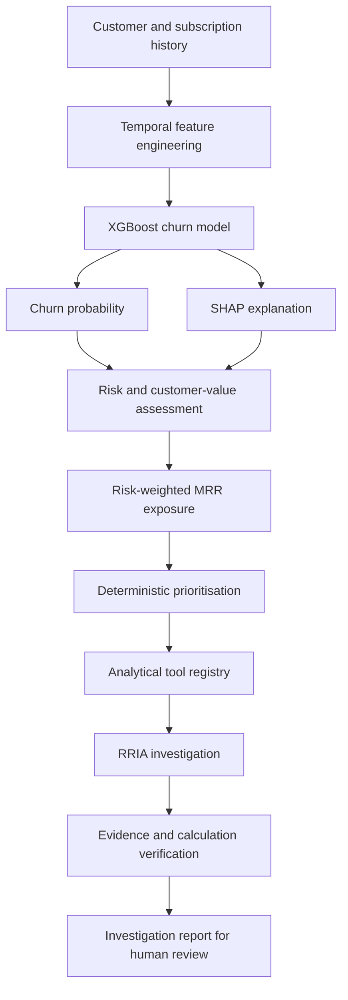
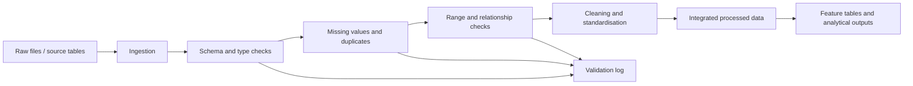
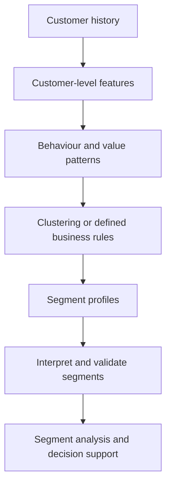
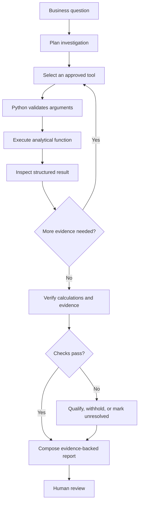
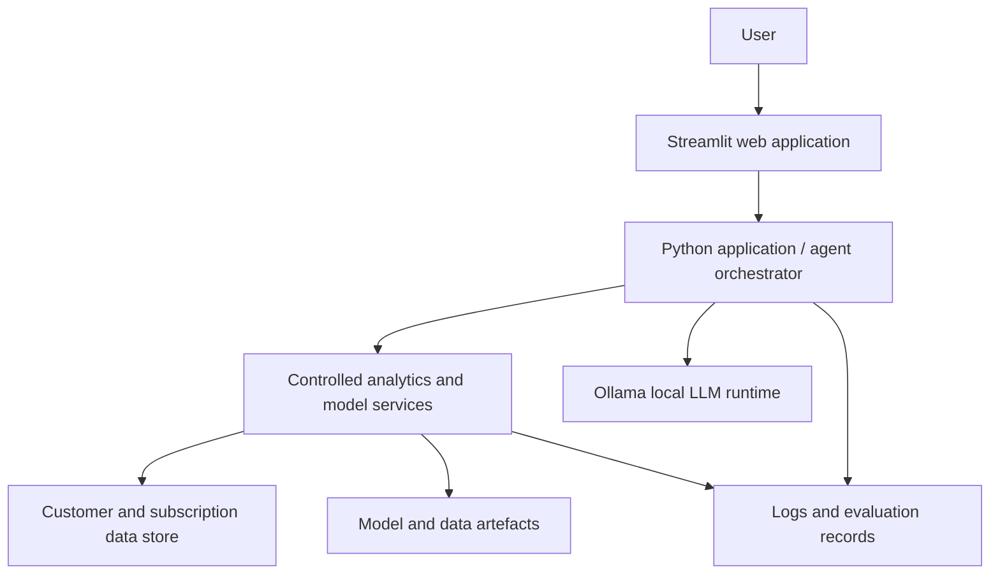

# RevLens
## Agentic AI for SaaS Revenue, Customer Intelligence & Churn Decision Support

RevLens is an academic project to design and build a SaaS analytics and customer-risk decision-support system. Its central workflow connects customer and subscription data with revenue analytics, customer segmentation, churn prediction, model explainability, and evidence-backed business investigations.

The focused risk-intelligence workflow uses XGBoost to estimate churn probability, SHAP to explain model-attributed feature contributions, deterministic calculations to estimate recurring revenue exposure, and an LLM-based Revenue Risk Investigation Agent (RRIA) to coordinate approved analytical tools. A Streamlit application is planned as the user-facing interface.

> **Project status:** Academic development project. This README documents the project specification, current design direction, proposed extensions, and development roadmap. It does not claim that all listed components have been implemented, deployed, or evaluated.

---

## Contents

- [1. Project at a glance](#1-project-at-a-glance)
- [2. Business problem](#2-business-problem)
- [3. Project scope](#3-project-scope)
- [4. System architecture](#4-system-architecture)
- [5. Data foundation](#5-data-foundation)
- [6. Business intelligence](#6-business-intelligence)
- [7. Customer intelligence and segmentation](#7-customer-intelligence-and-segmentation)
- [8. Predictive analytics](#8-predictive-analytics)
- [9. Customer value and revenue exposure](#9-customer-value-and-revenue-exposure)
- [10. Revenue Risk Investigation Agent](#10-revenue-risk-investigation-agent)
- [11. Streamlit application](#11-streamlit-application)
- [12. Evaluation and verification](#12-evaluation-and-verification)
- [13. Development segments and roadmap](#13-development-segments-and-roadmap)
- [14. Data quality, privacy, and governance](#14-data-quality-privacy-and-governance)
- [15. Deployment and MLOps direction](#15-deployment-and-mlops-direction)
- [16. Proposed repository structure](#16-proposed-repository-structure)
- [17. Technology stack](#17-technology-stack)
- [18. Limitations and responsible interpretation](#18-limitations-and-responsible-interpretation)
- [19. References](#19-references)
- [20. Academic project information](#20-academic-project-information)

---

## 1. Project at a glance

| Area | Project direction |
|---|---|
| Domain | SaaS analytics, customer intelligence, machine learning, and decision support |
| Core problem | Connect customer behaviour and subscription data to revenue performance and churn risk |
| Core predictive model | XGBoost churn classifier |
| Explainability | SHAP local and global feature attribution |
| Revenue risk | Risk-weighted recurring revenue exposure |
| Customer intelligence | Customer-level features, behavioural analysis, and segmentation |
| Agent | Revenue Risk Investigation Agent using a local LLM through Ollama |
| Interface | Streamlit application |
| Development context | University academic project, planned across research/design and implementation stages |

### Five functional blocks

1. **Data foundation:** ingest, clean, validate, and integrate relevant SaaS datasets.
2. **Business intelligence:** analyse revenue, acquisition, retention, churn, and unit economics where data permits.
3. **Customer intelligence:** engineer customer features, analyse behaviour, assess value, and create interpretable segments.
4. **Predictive intelligence:** estimate churn risk and, as an extension, explore revenue forecasting and anomaly detection.
5. **Decision support:** connect analytical findings, estimate financial exposure, and present verified insights through dashboards and agent-assisted investigations.

The narrower first risk-investigation workflow should be delivered before attempting the full breadth of the platform.

---

## 2. Business problem

SaaS businesses commonly hold information across several data domains:

- Customers and account attributes
- Subscriptions and plans
- Recurring revenue and billing activity
- Customer acquisition channels
- Product usage and engagement
- Support activity
- Business expenses, where available

Analysing these domains separately makes it difficult to connect revenue changes to customer behaviour, understand which customer groups are affected, or assess the economic importance of accounts at risk.

RevLens is organised around one central question:

> **How does customer behaviour affect revenue and business performance, and which findings should a business user investigate first?**

For example, a revenue decline is more useful when it can be decomposed into supported components, associated with affected plans or segments, connected to customer-level churn signals, and expressed as an estimate of recurring revenue exposure.

RevLens aims to move from isolated metrics to connected analysis. It is a decision-support system: findings and priorities are intended to help a person investigate and decide, not to autonomously contact customers or apply retention interventions.

---

## 3. Project scope

The scope is divided into a focused core and broader analytical extensions. This separation is deliberate: the project should demonstrate a reliable end-to-end workflow before expanding into every possible SaaS analytics capability.

### 3.1 Core risk-intelligence workflow

The core workflow is:

- Prepare customer, subscription, revenue, and product-activity data.
- Define a prediction point, churn target, and prediction horizon.
- Engineer features using information available at the prediction point.
- Train and evaluate an XGBoost churn model.
- Explain individual predictions using SHAP.
- Assess customer value using supported data.
- Calculate risk-weighted recurring revenue exposure.
- Apply explicit, reproducible prioritisation logic.
- Let the RRIA investigate business questions through controlled analytical tools.
- Verify findings and present a structured report for human review.

### 3.2 Broader SaaS intelligence scope

The wider project specification includes the following modules, subject to the availability and quality of appropriate data.

| Module | Questions addressed | Example analysis |
|---|---|---|
| SaaS revenue intelligence | What is happening to recurring revenue? | MRR, ARR, growth, new, expansion, contraction, and churned revenue |
| Acquisition analytics | Where are customers coming from, and which channels attract valuable customers? | Acquisition volume, conversion, CAC, channel revenue, channel retention |
| Retention analytics | Do customers stay, and how does retention vary? | Customer lifetime, cohort retention, retention by plan, channel, and segment |
| Churn intelligence | What happened, and which customers may leave next? | Historical churn analysis, churn prediction, revenue exposure |
| Customer intelligence | What kinds of customers does the business have? | Customer-level behavioural and value features |
| Segmentation | Which customers exhibit similar behaviour or value patterns? | RFM or other supported features, clustering, segment interpretation |
| Unit economics | Are acquisition and retention economics sustainable? | CAC, LTV, ARPU, margins, LTV:CAC, payback period |
| Predictive analytics | What might happen next, or what appears unusual? | Churn prediction; proposed revenue forecasting and anomaly detection |
| Insight generation | How do analytical findings connect? | Metric change → affected segment → customer evidence → estimated impact |
| Dashboard | What is happening, why, who is affected, and what is the impact? | Executive and analytical views with investigation results |

Not every metric can be calculated from every dataset. CAC, gross margin, contribution margin, LTV, payback period, and acquisition conversion require appropriate acquisition, cost, margin, or lifecycle data. Unsupported metrics should be marked unavailable rather than approximated without an explicit method.

### 3.3 Scope boundaries

The current design keeps the following distinctions explicit:

- Historical churn analysis describes what happened.
- Churn prediction estimates what may happen within a defined horizon.
- SHAP attributes model output to input features; it does not establish causation.
- Revenue exposure is an estimate based on a documented formula and assumptions.
- Customer priority is a separate business rule or score, not another name for churn probability.
- The LLM coordinates analytical tools; deterministic Python logic remains responsible for calculations and verification.

---

## 4. System architecture

### 4.1 High-level architecture

The architecture has four conceptual stages: data foundation, analytical services, investigation and verification, and user interface. The RRIA coordinates analytical capabilities rather than replacing them.



### 4.2 Customer risk and investigation workflow



### 4.3 Component responsibilities

| Component | Responsibility |
|---|---|
| Ingestion and preparation | Read source data, standardise formats, clean and validate records |
| Analytical data layer | Provide consistent data for metrics, features, and customer analysis |
| Business analytics | Calculate supported revenue, acquisition, retention, churn, and unit-economic measures |
| Customer feature pipeline | Build customer-level features at a defined observation point |
| Churn model | Estimate churn probability |
| SHAP explainer | Produce feature attributions for model predictions |
| Value and exposure logic | Calculate documented customer-value measures and revenue exposure |
| Prioritiser | Apply explicit business rules to rank accounts |
| Tool registry | Expose approved analytical functions and their argument schemas |
| Python orchestrator | Validate, execute, and record tool calls; enforce operational limits |
| LLM client | Interpret business questions and select relevant tools |
| Evidence verifier | Check numerical outputs, time alignment, model references, and report support |
| Streamlit application | Present metrics, customer risk profiles, investigation progress, and reports |

The dashboard and agent should call the same analytical services. The same metric or model output should not be independently recalculated in the UI or generated by the LLM.

---

## 5. Data foundation

The data foundation is the base of the project. Downstream analytics and model quality depend on the reliability, consistency, and timing of the underlying records.

### 5.1 Data domains

The project scope identifies these potential domains:

| Data domain | Possible contents | Main use |
|---|---|---|
| Customers | Customer/account identifier, segment attributes, region, industry | Customer profiles and segmentation |
| Subscriptions | Plan, status, start/end dates, billing cadence, plan changes | Lifecycle, churn, recurring revenue |
| Transactions and billing | Invoices, payments, charges, credits | Revenue and payment analysis |
| Acquisition | Channel, campaign, acquisition date, conversion | Acquisition and CAC analysis |
| Product activity | Sessions, feature use, active seats, activity dates | Engagement and churn features |
| Business expenses | Acquisition or service costs, if provided | Unit economics and profit-oriented analysis |

These are target data domains, not a claim that every source table has already been obtained.

### 5.2 Recommended dataset direction

The project research notes identify the **Synthetic B2B SaaS Churn & Revenue** dataset as the preferred primary source for the churn and behavioural workflow:

- Dataset: [Synthetic B2B SaaS Churn & Revenue](https://huggingface.co/datasets/arti199919/synthetic-saas-churn-sample)
- The reviewed free sample was described as containing 84,817 customer-month records.
- The described `user_monthly` grain is customer plus month.
- Fields listed in the research notes include subscription plan, monthly price/MRR, tenure, sessions, feature usage, support tickets, payment failures, NPS, product incidents, active seats, current churn, and a next-month churn label (`churned_next_month`).

The customer-month grain can support temporal feature engineering: observations up to month T can be used to predict the next-month label, provided the dataset's exact definitions and availability timestamps are confirmed before modelling.

The research notes also identify a complementary relational source for revenue and billing analysis:

- Dataset: [Mindweave Subscription Billing](https://huggingface.co/datasets/mindweave/subscription-billing)
- The reviewed notes describe six tables: customers, subscriptions, invoices, payments, plan changes, and churns.
- The notes describe 52,483 rows in the full version.

The two datasets should not be joined as though they describe the same customers. They are separate sources with separate schemas and should be used for complementary demonstrations unless a valid shared identity and integration design exists.

A further source mentioned for SQL and revenue analysis is [Datanemics SaaS Subscriptions](https://datanemics.com/datasets/saas-subscriptions/). The notes describe it as account-level rather than customer-month data, so it is not the preferred primary source for temporal churn modelling.

Dataset counts and field availability are taken from the project research notes and should be rechecked against the selected dataset version when data is downloaded. The free sample and any advertised full release may differ.

### 5.3 ETL workflow



The planned ETL steps are:

1. Load source tables and inspect their structure.
2. Validate expected columns and data types.
3. Check missing values and define handling rules.
4. Check duplicate records and key uniqueness.
5. Validate relationships between customer, subscription, transaction, and activity records.
6. Standardise dates, currencies, categories, and identifiers.
7. Apply range and consistency checks.
8. Record validation results and exceptions.
9. Store the cleaned, documented data for analytics and modelling.

### 5.4 Data-quality checks

| Check | Example rule |
|---|---|
| Schema | Required customer, date, MRR, and target fields must exist |
| Data types | Dates parse as dates; MRR and activity measures are numeric |
| Missingness | Unexpected nulls in required fields are logged and handled by defined rules |
| Ranges | MRR must be non-negative where the metric definition requires it; churn label must be binary |
| Uniqueness | Keys such as customer-month should be unique at the declared grain |
| Relationships | Subscription and activity records must reference valid customer identifiers |
| Temporal integrity | No future-dated records where the source definition disallows them |
| Statistical anomalies | Unusual shifts in churn rate or revenue measures are flagged for review |

Validation failure should not silently pass into model training. The pipeline should distinguish warnings from blocking errors and preserve a record of the decision taken.

### 5.5 Data dictionary and lineage

A data dictionary should define each field, source, grain, type, units, null handling, and business meaning. For model features, record the observation window and the latest timestamp from which the feature is allowed to draw data.

---

## 6. Business intelligence

Business intelligence describes historical and current business performance. It is separate from predictive analytics.

### 6.1 SaaS revenue intelligence

The revenue module is intended to analyse:

- Monthly Recurring Revenue (MRR)
- Annual Recurring Revenue (ARR)
- Revenue growth
- New MRR
- Expansion MRR
- Contraction MRR
- Churned MRR

Revenue can be broken down by subscription plan, customer segment, acquisition channel, cohort, and region where those dimensions are available.

A revenue movement should be explained through its supported components rather than shown only as a percentage change. Reconciliation rules must be defined for the selected dataset and reporting period.

### 6.2 Acquisition analytics

The acquisition module is intended to analyse:

- Customers acquired by channel
- Acquisition volume
- Conversion
- Customer Acquisition Cost (CAC)
- Revenue generated by channel
- Retention by channel

The objective is not simply to identify the channel with the highest customer count. It is to assess whether acquired customers remain active and generate sufficient value relative to acquisition cost. CAC and conversion analysis require the corresponding spend and funnel data.

### 6.3 Retention analytics

The retention module is intended to examine:

- Customer retention
- Customer lifetime
- Cohort retention
- Retention by plan
- Retention by acquisition channel
- Retention by segment and customer type

The goal is to identify patterns that distinguish customers who stay from customers who leave. Definitions of active customer, retained customer, churn event, and cohort start must remain consistent throughout the analysis.

### 6.4 Historical churn analysis

Historical analysis answers **what happened?** Example views include churn rate by plan, cohort, channel, and segment, as well as revenue lost through churn.

Churn prediction answers **what might happen next?** The two should be presented separately in the dashboard and reports.

### 6.5 Unit economics

Potential measures include:

- Customer Acquisition Cost (CAC)
- Customer Lifetime Value (LTV)
- Average Revenue Per User (ARPU)
- Gross margin
- Contribution margin
- LTV:CAC
- Payback period

These metrics depend on precise definitions and data coverage. For example, revenue alone is not enough to calculate profit or contribution margin; cost data is required.

---

## 7. Customer intelligence and segmentation

Customer intelligence creates a customer-level view of behaviour, engagement, subscription history, and economic value.

### 7.1 Customer feature groups

Potential feature groups include:

- Spending and recurring revenue
- Subscription history and plan changes
- Tenure
- Product activity and engagement
- Session and feature-usage behaviour
- Support activity
- Revenue contribution

The final feature list must be determined by the chosen data source and prediction design.

### 7.2 Segmentation workflow



Potential methods include RFM features (Recency, Frequency, Monetary), K-means, Gaussian Mixture Models, or other clustering approaches if justified by the data. The number and meaning of clusters should be evaluated rather than selected solely to produce attractive labels.

Illustrative segment descriptions include:

- High-value, loyal customers
- High-value customers with declining engagement
- Low-value, active customers
- Low-engagement customers

These are examples of possible interpretations, not established results from the project dataset.

### 7.3 Integration with churn and prioritisation

The existing analytical design includes a `get_segment_analysis` capability. The proposed enhancement is to use segment information more deeply:

- Calculate segment-level churn and revenue metrics.
- Include segment context in investigation reports.
- Evaluate segment indicators as candidate model features.
- Compare churn behaviour across segments.
- Consider segment-specific customer value or intervention costs if those data become available.

Segment labels should not be treated as inherently meaningful. Segment quality and stability must be examined, and any use in model training must be tested for leakage and added predictive value.

---

## 8. Predictive analytics

Predictive analytics extends the project beyond historical reporting. Churn prediction is the central model workflow; revenue forecasting and anomaly detection are broader proposed extensions.

### 8.1 Churn prediction

The churn model asks:

> Which customers may churn within the defined future observation period?

Planned outputs:

- Churn probability
- Risk category based on documented thresholds
- Potential recurring revenue exposure

XGBoost is the selected primary model in the current specification. Baseline comparisons and model metrics should be reported after implementation, not assumed in advance.

### 8.2 Revenue forecasting — proposed extension

Revenue forecasting would use historical revenue patterns to estimate future revenue. Possible outputs include expected future revenue, a forecast range, and trend direction.

The forecasting method, horizon, input data, and validation approach have not been fixed in the current specification. This module should be attempted only after revenue definitions and historical coverage are reliable.

### 8.3 Anomaly detection — proposed extension

Anomaly detection would flag unusual events for investigation, such as:

- Sudden revenue drops
- Unusual customer behaviour
- Unexpected churn spikes
- Abnormal transaction patterns

An anomaly is a signal for review, not proof of fraud, error, or a particular business cause. Thresholds and detection methods require evaluation.

---

## 9. Customer value and revenue exposure

RevLens separates churn risk, customer value, recurring revenue exposure, and business priority.

### 9.1 Risk-weighted recurring revenue exposure

The initial documented estimate is:

```text
Risk-weighted MRR exposure
    = Churn probability × Customer MRR
```

For example, a customer with an estimated churn probability of 0.80 and MRR of $5,000 has risk-weighted MRR exposure of $4,000.

This is an estimate associated with the model's prediction and chosen MRR definition. It is not a guaranteed loss, a forecast of realised churned revenue, or a measure of profit.

### 9.2 Customer prioritisation

The current design intends to prioritise accounts using a combination of:

- Churn probability
- Customer value
- Revenue exposure
- Evidence quality, if implemented

The exact priority rule must be defined in deterministic code, documented, and tested. The model or LLM must not silently change customer rankings.

### 9.3 Proposed profit-oriented enhancement

The research report identifies a limitation in ranking accounts by risk-weighted MRR alone: this does not account for retention cost or differences in future customer value.

A proposed extension is to evaluate an expected-profit or incremental-profit-based prioritisation method. It would require:

1. A defensible estimate of customer lifetime value (CLV), if the data supports it.
2. A defined retention intervention and its cost.
3. A model or assumption for the incremental probability that the intervention prevents churn.
4. A calculation of expected financial benefit net of intervention cost.
5. A comparison against the simpler risk-weighted MRR ranking.

The research report includes the illustrative expression:

```text
expected_profit_lift = churn_probability × CLV - retention_cost
```

This should be treated as a proposed simplified estimate, not a validated profit model. In particular, it assumes a relationship between churn probability and loss avoided; a production-quality intervention model would need to account for the chance that an intervention actually changes the outcome. The project should not replace the existing exposure metric until the required data and assumptions can be justified.

### 9.4 Segment-aware value

A further proposed enhancement is to evaluate whether customer value, expected retention cost, and decision thresholds differ by segment. This requires segment validation and supporting financial data; it is not a current implemented capability.

---

## 10. Revenue Risk Investigation Agent

### 10.1 Purpose

The Revenue Risk Investigation Agent (RRIA) is the agentic AI layer. A business user submits a natural-language question; the agent selects permitted analytical tools, receives structured results, inspects whether more evidence is needed, and produces a report grounded in those results.

The agent coordinates analysis. It does not replace the churn model, SHAP, revenue calculations, or deterministic prioritisation logic.

### 10.2 Investigation lifecycle



The orchestrator owns permissions, argument validation, tool execution, error handling, timeouts, maximum tool-call limits, and investigation state. The LLM does not control these safeguards.

### 10.3 Example investigation

Example business question:

> Our revenue growth has slowed this month. Investigate what is happening, identify affected customer segments and accounts, estimate recurring revenue exposed to churn risk, and identify which accounts should be investigated first.

A possible workflow:

1. Retrieve current and comparison-period revenue KPIs.
2. Compare MRR and supported revenue movement components.
3. Decompose revenue change into new, expansion, contraction, and churned MRR where data permits.
4. Identify affected plans, cohorts, or segments.
5. Retrieve relevant customer and subscription profiles.
6. Retrieve available churn predictions for relevant customers.
7. Retrieve SHAP explanations linked to those predictions.
8. Retrieve historical activity where available.
9. Calculate risk-weighted MRR exposure.
10. Apply deterministic customer prioritisation.
11. Verify calculations and evidence before writing the report.

The agent should select follow-up tools based on intermediate results. It should not call every tool for every query.

### 10.4 Initial analytical tool registry

The project design identifies the following logical tool capabilities:

| Tool | Intended responsibility |
|---|---|
| `get_revenue_kpis` | Retrieve validated KPIs for a reporting period |
| `compare_revenue_periods` | Compare current and reference-period metrics |
| `decompose_revenue_change` | Inspect supported MRR movement components |
| `get_segment_analysis` | Retrieve customer or subscription segment analysis |
| `get_customer_profile` | Retrieve customer and subscription context |
| `get_churn_prediction` | Retrieve a prediction and associated model metadata |
| `get_shap_explanation` | Retrieve the explanation associated with a particular prediction |
| `get_customer_activity_history` | Retrieve historical behavioural observations |
| `calculate_revenue_exposure` | Apply the documented exposure formula |

These are planned tool interfaces. The implementation may group several capabilities into shared modules, provided each tool has a clear contract.

Every tool should define:

- Purpose and name
- Typed, validated arguments
- Structured return schema
- Controlled data access
- Clear error states
- Tests for normal, empty, and invalid inputs

### 10.5 Agent constraints

The initial design is deliberately conservative:

- No unrestricted SQL execution.
- No arbitrary Python or shell execution by the LLM.
- No autonomous customer emails or CRM changes.
- No automatic discounts or retention interventions.
- No LLM-generated churn probabilities or SHAP values.
- No autonomous alteration of deterministic calculations or customer rankings.
- No automatic learning from prior investigations in the initial version.
- No claim of real-time monitoring unless it is implemented and measured.

The agent is read-only decision support. Human review remains part of the workflow.

### 10.6 Investigation state and traceability

The Python orchestrator should record structured information for each investigation:

- Investigation identifier and original question
- Reporting and comparison periods
- Investigation plan and current stage
- Tool names, validated arguments, execution status, and results
- Relevant customer identifiers and evidence references
- Data snapshot and prediction timestamps
- Model version, when available
- Verification outcomes
- Errors, limitations, unresolved questions, and report metadata

Important report claims should be traceable to analytical results. A SHAP explanation must be associated with the correct customer, model prediction, and feature snapshot.

### 10.7 Verification safeguards

Verification must be performed by deterministic checks rather than relying only on the LLM to review its own response.

Checks should cover:

- Revenue calculations and metric definitions
- Revenue-movement reconciliation where supported
- Reporting-period and data-snapshot alignment
- Customer identifier validity
- Prediction availability and timestamp
- SHAP-to-prediction association
- Exposure inputs and formula
- Customer priority against deterministic output
- Whether report statements are supported by returned evidence

Failed checks should cause a finding to be withheld, qualified, or marked unresolved.

### 10.8 Investigation report format

A standard report should contain:

1. Investigation question and reporting period
2. Executive finding
3. Revenue movements
4. Segment findings
5. Relevant customer accounts
6. Churn predictions and SHAP evidence
7. Revenue exposure and assumptions
8. Prioritised accounts
9. Suggested areas for human investigation
10. Limitations and unanswered questions

The report must distinguish observed facts, model predictions, model-attributed contributors, calculated estimates, and recommendations.

### 10.9 Feedback and model improvement — proposed extension

The gap-analysis report notes that the existing design does not capture confirmed outcomes of investigations or retention efforts for later model updates. It also identifies automatic learning from previous investigations as outside the initial agent scope.

A future model feedback process could:

1. Record subsequent churn outcomes and retention-effort outcomes with timestamps.
2. Update ground-truth labels only when outcomes become observable.
3. Preserve dataset and label versions.
4. Retrain on a defined monthly or quarterly schedule, or after a justified drift trigger.
5. Evaluate the candidate model against a holdout or temporal test set.
6. Compare predictive and business metrics before promotion.

Optional active-learning work could identify uncertain or high-impact cases for human review. It must not treat an unconfirmed prediction or an LLM-generated explanation as a ground-truth label.

---

## 11. Streamlit application

Streamlit is the planned user interface. It should display the outputs of shared analytical services rather than reimplementing model or business logic.

### 11.1 Executive overview

Possible content:

- Revenue and retention KPIs
- Churn overview
- Revenue exposure estimate
- High-priority customer summary
- Relevant business findings

### 11.2 Customer risk

Possible content:

- Customer profile and subscription context
- MRR and supported customer-value measures
- Predicted churn probability and risk category
- SHAP contributors with actual feature values
- Risk-weighted revenue exposure
- Business priority and its rationale
- Historical activity where available

### 11.3 AI investigation

Possible content:

- Natural-language business question
- Reporting-period selection
- Investigation progress from actual orchestrator events
- Tool execution status and structured results
- Supporting evidence
- Prioritised customer findings
- Investigation report
- Verification status, errors, and limitations

Progress indicators must reflect real tool execution. The UI should not simulate tool calls or display fabricated intermediate outputs.

### 11.4 Broader dashboard sections

As supporting data and implementation mature, the dashboard may include Revenue, Acquisition, Retention, Churn, Customer Intelligence, Unit Economics, Predictions, Anomalies, and Insights.

---

## 12. Evaluation and verification

Model performance, analytical correctness, explainability, and agent reliability are separate evaluation areas.

### 12.1 Churn model

Candidate metrics:

- Precision
- Recall
- F1-score
- ROC-AUC
- PR-AUC / Average Precision
- Confusion matrix
- Probability calibration

Evaluation must consider class imbalance and use a split strategy consistent with the temporal structure. Random splitting of customer-month records can leak information across time or across the same customer; the final approach must be justified.

### 12.2 Explainability

Check that:

- SHAP values correspond to the intended model and prediction.
- Feature names and actual customer values are correct.
- Explanations are consistent with the model output.
- Wording describes attribution rather than unsupported causation.

### 12.3 Revenue and prioritisation

Check that:

- KPI definitions and calculations are documented.
- Revenue movement reconciles where the source data supports reconciliation.
- Exposure uses the correct prediction and MRR snapshot.
- Customer-value definitions are reproducible.
- Customer rankings match deterministic prioritisation logic.

The proposed profit-oriented method should be compared with risk-weighted MRR only when the necessary CLV, cost, and intervention assumptions can be supported.

### 12.4 Agent evaluation

| Dimension | Evaluation question |
|---|---|
| Tool selection | Did the agent select tools relevant to the user's question? |
| Argument validity | Were tool inputs valid and within permitted limits? |
| Evidence accuracy | Do report claims match returned analytical data? |
| Investigation completeness | Was the required evidence retrieved? |
| Calculation integrity | Did deterministic verification pass? |
| Traceability | Can important findings be traced to their evidence? |
| Limitation handling | Did the agent acknowledge missing or insufficient evidence? |
| Decision-support usefulness | Does the report connect findings more usefully than isolated metrics? |

### 12.5 Initial investigation scenarios

1. **Revenue growth slowdown:** identify supported revenue movements, affected segments, and relevant accounts.
2. **High-value customer investigation:** inspect a high-value account with elevated predicted churn risk.
3. **Segment-level churn investigation:** identify segments with elevated churn indicators and associated revenue exposure.

Test outputs should be manually checked against source data and deterministic tool results. The project must not assume that agent-assisted prioritisation is better until it is evaluated.

---

## 13. Development segments and roadmap

Development is divided into segments so that each layer has a clear input, output, and validation objective. The sequence below combines the documented phase plan with the gap-analysis recommendations. It is a roadmap, not a claim that all work is complete.

### Segment 1 — Research, scope, and dataset selection

**Objective:** Establish the business question, deliverable boundaries, and data feasibility.

Work:
- Review churn prediction, explainability, profit-based retention, segmentation, and agent reliability literature.
- Confirm the selected datasets and their licence, schema, grain, and limitations.
- Define churn, active customer, customer-month, MRR, and the prediction horizon.
- Decide which business metrics are actually supported.
- Define initial model and agent evaluation criteria.

Deliverables:
- Project scope and research notes
- Dataset assessment and data dictionary draft
- Churn target and prediction-window definition
- Initial evaluation plan

### Segment 2 — Data ingestion, validation, and integration

**Objective:** Build a reliable data foundation before modelling.

Work:
- Load source files or tables.
- Validate schemas, types, keys, and relationships.
- Profile missingness, duplicates, ranges, and date integrity.
- Standardise formats and categories.
- Clean and integrate the required data domains.
- Log validation outcomes and document unresolved issues.

Deliverables:
- Reproducible ingestion and cleaning scripts
- Validation rules and tests
- Processed datasets
- Data dictionary and known-data-limitations record

### Segment 3 — Business and customer analytics

**Objective:** Establish trusted descriptive metrics and customer-level views.

Work:
- Calculate supported revenue metrics.
- Analyse acquisition and retention where source fields permit.
- Build historical churn summaries.
- Create customer profiles and behavioural summaries.
- Build cohort and segment-level analysis where feasible.
- Document metric definitions and reconciliation logic.

Deliverables:
- Reusable analytical functions
- Revenue and customer analysis outputs
- Segment-analysis baseline
- Tests for metric calculations

### Segment 4 — Feature engineering and churn modelling

**Objective:** Build a leakage-aware churn prediction workflow.

Work:
- Define the observation and prediction windows.
- Engineer temporal customer features using only information available by the prediction point.
- Establish a simple baseline.
- Train and tune XGBoost.
- Evaluate using suitable classification and ranking metrics.
- Record model parameters, data version, and evaluation results.

Deliverables:
- Feature-generation pipeline
- Model training and evaluation code
- Versioned model artefact
- Evaluation report and limitations

### Segment 5 — SHAP explainability

**Objective:** Explain individual predictions and assess model behaviour.

Work:
- Generate local SHAP explanations.
- Examine global feature attribution.
- Map technical feature names to deterministic descriptions.
- Verify explanations against the corresponding prediction and feature snapshot.
- Preserve the non-causal interpretation boundary.

Deliverables:
- SHAP explanation functions
- Customer-level explanation output
- Global explainability analysis
- Attribution and consistency tests

### Segment 6 — Customer value, exposure, and prioritisation

**Objective:** Translate model risk into a transparent financial estimate and review order.

Work:
- Define customer-value measures supported by the dataset.
- Implement risk-weighted MRR exposure.
- Define and test deterministic prioritisation logic.
- Document assumptions and missing inputs.
- Prototype CLV/profit-oriented ranking only if cost and intervention data can support it.
- Compare alternative rankings using clearly defined evaluation criteria.

Deliverables:
- Exposure calculation
- Customer-value definitions
- Reproducible prioritisation function
- Comparison and assumptions report

### Segment 7 — Core Streamlit application

**Objective:** Make the analytical outputs accessible to a user.

Work:
- Build executive and customer-risk views.
- Display model probability, SHAP contributors, exposure, and priority.
- Use shared analytical functions.
- Display missing data and metric limitations clearly.

Deliverables:
- Initial Streamlit application
- Executive overview
- Customer-risk profile view

### Segment 8 — Agent tool foundation

**Objective:** Expose approved analytical functions through stable interfaces.

Work:
- Define tool names, argument schemas, and result structures.
- Implement controlled data access.
- Add normal, empty, and invalid-input tests.
- Ensure tools use the same calculations as the dashboard.
- Add logging and predictable error responses.

Deliverables:
- Tool registry
- Tested Python analytical tools
- Tool interface documentation

### Segment 9 — LLM integration and orchestration

**Objective:** Connect a local LLM to the controlled tool layer.

Work:
- Integrate the Ollama client.
- Define prompts and tool descriptions.
- Implement the Python orchestrator.
- Validate all tool arguments before execution.
- Maintain investigation state.
- Add timeouts, call limits, and error handling.
- Start with the narrow MRR-growth-slowdown investigation.

Deliverables:
- LLM client
- Orchestrator and investigation state
- Working narrow tool-calling workflow
- Execution trace

### Segment 10 — Verification, reporting, and investigation UI

**Objective:** Make agent outputs evidence-grounded and reviewable.

Work:
- Implement deterministic verification checks.
- Link report claims to structured tool outputs.
- Add investigation progress to Streamlit.
- Create a structured investigation report.
- Test incomplete evidence and failed-verification paths.

Deliverables:
- Evidence verifier
- Report generator
- Investigation interface
- Scenario-based agent evaluation

### Segment 11 — Advanced extensions and feedback design

**Objective:** Extend the system only after the core workflow is reliable.

Candidate work:
- RFM-based feature engineering and clustering
- Segment-aware churn analysis and prioritisation
- CLV and profit-oriented prioritisation when supported by data
- Revenue forecasting
- Anomaly detection
- Outcome capture and periodic model retraining
- Drift evaluation and optional active-learning workflow

Deliverables depend on validated scope and available data. These are extensions, not prerequisites for describing the core system.

### Segment 12 — Privacy, deployment, monitoring, and final evaluation

**Objective:** Prepare a reproducible and responsibly operated project demonstration.

Work:
- Apply privacy and access-control requirements appropriate to the data.
- Pin dependencies and record random seeds.
- Package components for a selected local or hosting environment.
- Add CI tests and structured logs.
- Monitor service errors and, where operational, model/data drift.
- Run end-to-end evaluation and document limitations.

Deliverables:
- Reproducible environment
- Deployment configuration appropriate to the chosen environment
- Test and monitoring setup
- Final technical and evaluation documentation

### Roadmap summary

| Segment | Focus | Main output |
|---|---|---|
| 1 | Research and scope | Defined problem, dataset, and metrics |
| 2 | Data foundation | Validated and documented data |
| 3 | Business/customer analytics | Trusted descriptive analysis |
| 4 | Churn modelling | Evaluated XGBoost workflow |
| 5 | Explainability | Verified SHAP outputs |
| 6 | Value and exposure | Exposure and deterministic priority |
| 7 | Core dashboard | Executive and customer-risk views |
| 8 | Tool foundation | Tested analytical tool registry |
| 9 | Agent integration | Controlled LLM orchestration |
| 10 | Verification and reporting | Evidence-backed investigation workflow |
| 11 | Advanced extensions | Segmentation, profit, forecasting, anomaly, feedback work |
| 12 | Deployment and evaluation | Reproducible demonstration and final assessment |

### First end-to-end agent milestone

The first agent milestone should be deliberately narrow.

**Question:** “Why has MRR growth slowed this month?”

**Initial tools:**
1. `get_revenue_kpis`
2. `compare_revenue_periods`
3. `decompose_revenue_change`

**Success criteria:**
- The LLM selects relevant tools.
- Python validates and executes the calls.
- Results contain actual analytical values.
- The agent identifies only supported contributors to the slowdown.
- Deterministic checks verify calculations.
- The final report matches tool outputs and states limitations.

Customer-level, segment, churn, and SHAP investigation should be added after this workflow is reliable.

---

## 14. Data quality, privacy, and governance

### 14.1 Data quality controls

Validation should run before analytics and model training. Recommended controls include:

- Required-column and type validation
- Missing-value checks with documented handling
- Primary-key and grain uniqueness checks
- Referential-integrity checks
- Numeric range and cross-field consistency checks
- Date and time-window validation
- Statistical anomaly flags for key revenue and churn measures
- Unit tests for analytical tools
- Logs for validation failures and exceptional records

The project may use custom Pandas validation or a validation framework such as [Great Expectations](https://greatexpectations.io/). Orchestration may initially use straightforward Python scripts; a workflow tool such as Apache Airflow is an optional extension rather than a requirement.

### 14.2 Feedback and model monitoring

The gap analysis identifies the absence of a model feedback loop as a design gap. A future workflow should capture confirmed outcomes of churn and retention activities, preserve timestamps and label versions, and retrain periodically only after evaluation.

Model monitoring may include:
- Data schema and distribution changes
- Feature and prediction drift
- Model performance once new labels become available
- Calibration changes
- Segment-level performance differences

A detected change should trigger investigation; it should not automatically imply that a new model is safe to deploy.

### 14.3 Privacy and compliance plan

The current project notes identify privacy and legal compliance as areas missing from the earlier README. The following are proposed design controls, not a claim of completed legal review:

1. **Data minimisation:** collect only fields needed for the defined analysis.
2. **PII handling:** remove or mask direct identifiers where they are not required.
3. **Pseudonymisation:** use project-specific identifiers in analytical datasets when appropriate.
4. **Access control:** restrict access to source and processed data.
5. **Encryption:** protect data at rest and in transit where the selected environment supports it.
6. **Data retention:** define how long raw data, derived data, and investigation logs are retained.
7. **Governance:** document data sources, permitted uses, and responsibility for review.

If real customer data is introduced, applicable legal requirements must be determined from the data subjects, organisation, jurisdiction, and data type. The research report mentions GDPR and notes FERPA or HIPAA only where student or health information is relevant. Those regimes should not be presented as automatically applicable to ordinary SaaS account data. Obtain appropriate institutional or legal guidance before using real personal data.

The [NIST AI Risk Management Framework](https://nvlpubs.nist.gov/nistpubs/ai/NIST.AI.100-1.pdf) is identified in the research report as a reference for privacy-enhanced and trustworthy AI design.

---

## 15. Deployment and MLOps direction

Deployment is not specified as a completed capability. The research report proposes the following future direction.

### 15.1 Proposed component packaging



A possible future deployment could separate:

- Streamlit web application
- Python agent orchestrator and analytical tools
- Churn model-serving interface, if a separate service is warranted
- Relational data storage and object storage for snapshots or model artefacts
- Ollama runtime for local LLM inference

A separate REST model service, for example using FastAPI, is an option rather than an established implementation decision.

### 15.2 Cloud or on-premises

Possible environments from the research plan include:

- **Cloud:** AWS, Google Cloud, or Azure, using managed compute and database services where appropriate.
- **On-premises or university-hosted:** Docker Compose or another suitable local deployment approach where data must remain within a controlled environment.

The project should choose an environment based on data constraints, available infrastructure, cost, and demonstration requirements. Kubernetes is a possible scaling option, not a necessary first deployment target.

### 15.3 CI/CD and reproducibility

Proposed practices:

- Run automated tests on pushes through GitHub Actions or an equivalent CI service.
- Pin Python dependency versions.
- Record Python and environment versions.
- Fix and record random seeds for experiments.
- Version model artefacts and dataset snapshots.
- Separate development, test, and deployment configuration.
- Build and publish container images only if container deployment is adopted.

### 15.4 Monitoring and logs

Potential operational tools include Prometheus and Grafana for system metrics, and a centralised logging service for application and investigation records.

Useful signals include:
- Request latency and error rate
- Tool-call failures and timeouts
- Verification failures
- Data validation failures
- Model performance and drift when labels become available

Logs should avoid unnecessarily storing personal or sensitive customer data.

---

## 16. Proposed repository structure

The following is a logical target structure, not a verified inventory of the current repository. Directories and modules should be added as the corresponding work is implemented.

```text
RevLens/
├── data/
│   ├── raw/
│   ├── processed/
│   └── features/
├── notebooks/
├── src/
│   ├── ingestion/
│   ├── preprocessing/
│   ├── features/
│   ├── analytics/
│   │   ├── revenue_analysis.py
│   │   ├── customer_analysis.py
│   │   └── segment_analysis.py
│   ├── modeling/
│   │   └── churn_model.py
│   ├── explainability/
│   │   └── shap_explainer.py
│   ├── prioritization/
│   │   ├── revenue_exposure.py
│   │   └── customer_priority.py
│   ├── tools/
│   │   ├── revenue_tools.py
│   │   ├── customer_tools.py
│   │   └── churn_tools.py
│   └── agent/
│       ├── llm_client.py
│       ├── orchestrator.py
│       ├── tool_registry.py
│       ├── investigation_state.py
│       ├── prompts.py
│       ├── verifier.py
│       └── report_generator.py
├── app/
│   ├── streamlit_app.py
│   └── pages/
│       └── investigation.py
├── tests/
│   ├── test_analytics.py
│   ├── test_agent_tools.py
│   ├── test_orchestrator.py
│   ├── test_verifier.py
│   └── test_investigations.py
├── models/
├── configs/
├── requirements.txt
└── README.md
```

Do not create empty placeholder modules merely to match this diagram. The actual repository layout should reflect implemented code.

---

## 17. Technology stack

The following stack is specified or proposed for the project. Specific packages should be added only when required by implementation.

| Technology | Role |
|---|---|
| Python | Data processing, analytics, modelling, tool execution, and orchestration |
| SQL | Structured data retrieval and analysis |
| Pandas / NumPy | Data preparation and numerical operations |
| Scikit-learn | Preprocessing, supporting methods, and model evaluation |
| XGBoost | Churn prediction |
| SHAP | Model explainability |
| Ollama | Local LLM inference for the investigation agent |
| Streamlit | Interactive application |
| Matplotlib / Seaborn / Plotly | Data visualisation where appropriate |
| Pytest | Automated tests |
| Great Expectations or custom validators | Optional data-quality validation |
| Docker | Proposed application packaging |
| GitHub Actions | Proposed continuous integration |
| Prometheus / Grafana | Optional monitoring direction |

---

## 18. Limitations and responsible interpretation

RevLens can investigate only the information represented in its available data.

It cannot automatically determine:
- A customer's private reason for cancelling
- An unrecorded competitor influence
- A business decision not represented in the data
- Whether a retention action will succeed

Additional limitations:

- Synthetic data can demonstrate a workflow but does not establish real-world business performance.
- A model trained on one SaaS dataset may not generalise to another business.
- Customer-month records require careful time-based splitting and leakage prevention.
- SHAP explains model behaviour, not causation.
- Risk-weighted MRR is an estimate, not guaranteed revenue loss.
- Profit-oriented prioritisation requires CLV, cost, and intervention-effect assumptions.
- Segmentation results depend on feature design and require validation.
- An LLM can select inappropriate tools or summarise evidence incorrectly; deterministic validation and verification are required.
- Missing, delayed, or stale data can make an investigation incomplete.

The system should report insufficient evidence rather than invent explanations, financial values, or recommendations. Human review remains central to the intended decision-support workflow.

---

## 19. References

The references below are the sources listed in the project gap-analysis report. They motivate design choices and proposed extensions; they should not be read as proof that a cited method has already been implemented or validated in RevLens.

1. **Imani, M. et al. (2025).** “Customer Churn Prediction: A Systematic Review of Recent Advances, Trends, and Challenges in ML and DL.” *Machine Learning and Knowledge Extraction*, 7(3), 105. [https://doi.org/10.3390/make7030105](https://doi.org/10.3390/make7030105)
2. **Guliyev, E. et al. (2025).** “Improving B2B Customer Churn through Action Rule Mining.” *Industrial Marketing Management*, 125, 1–11. [https://doi.org/10.1016/j.indmarman.2024.12.005](https://doi.org/10.1016/j.indmarman.2024.12.005)
3. **Curiskis, S. et al. (2023).** “A novel approach to predicting customer lifetime value in B2B SaaS companies.” *Journal of Marketing Analytics*, 11, 587–601. [https://doi.org/10.1057/s41270-023-00234-6](https://doi.org/10.1057/s41270-023-00234-6)
4. **Chen, T. and Guestrin, C. (2016).** “XGBoost: A Scalable Tree Boosting System.” *Proceedings of KDD 2016*. [https://doi.org/10.5555/2939672.2939785](https://doi.org/10.5555/2939672.2939785)
5. **Lundberg, S. M. and Lee, S.-I. (2017).** “A Unified Approach to Interpreting Model Predictions.” *NeurIPS 2017*. [https://doi.org/10.48550/arXiv.1705.07874](https://doi.org/10.48550/arXiv.1705.07874)
6. **Lemmens, M. and Gupta, S. (2020).** “Managing Churn to Maximize Profits.” *Marketing Science*, 39(6), 1100–1117. [https://doi.org/10.1287/mksc.2020.1218](https://doi.org/10.1287/mksc.2020.1218)
7. **Ibrahim, S. et al. (2026).** “A novel hybrid DL framework for churn prediction using RFM and embedding clustering.” *Scientific Reports*, 16, 16563. [https://doi.org/10.1038/s41598-026-53220-0](https://doi.org/10.1038/s41598-026-53220-0)
8. **Schick, T. et al. (2023).** “Toolformer: Language Models Can Teach Themselves to Use Tools.” *NeurIPS 2023*. [https://doi.org/10.48550/arXiv.2302.04761](https://doi.org/10.48550/arXiv.2302.04761)
9. **Yao, S. et al. (2023).** “ReAct: Synergizing Reasoning and Acting in Language Models.” *ICLR 2023*. [https://doi.org/10.48550/arXiv.2210.03629](https://doi.org/10.48550/arXiv.2210.03629)
10. **Liu, X. et al. (2024).** “AgentBench: Evaluating LLMs as Agents.” *ICLR 2024*. [https://iclr.cc](https://iclr.cc)
11. **NIST (2023).** *Artificial Intelligence Risk Management Framework (AI RMF 1.0).* NIST AI 100-1. [PDF](https://nvlpubs.nist.gov/nistpubs/ai/NIST.AI.100-1.pdf)

**Reference-quality note:** The gap-analysis report also listed an El Attar and El-Hajj (2026) Frontiers in AI item with a placeholder DOI and an industry blog entry with a generic homepage link. Those entries are not included as formal references because the supplied report itself marks the DOI as a placeholder or does not provide a specific article URL. Verify bibliographic details independently before citing them in an academic submission.

---

## 20. Academic project information

**Title:** RevLens: Agentic AI for SaaS Revenue, Customer Intelligence & Churn Decision Support

**Domain:** Data Analytics, Business Intelligence, Machine Learning, and Artificial Intelligence

**Platform and technologies:** Python, SQL, Streamlit, XGBoost, SHAP, and Ollama

**Project type:** B.E. VII Semester CSE Project Work I, Academic Year 2026–27

**Authors:**
- Abdul Rab
- Bonthu Sai Vennela
